<!-- Banner animado: cambia solo entre modo claro y oscuro -->
<picture>
  <source media="(prefers-color-scheme: dark)" srcset="./art/header-dark.svg">
  <source media="(prefers-color-scheme: light)" srcset="./art/header-light.svg">
  
</picture>

---

### `// ABOUT & CREDENTIALS`

I'm **Brayan Stiven Charry Vela**, a **Systems Engineering student at Universidad del Cauca (Colombia)** focused on **backend development, web applications, and applied AI & statistical analysis**.

<table>
  <tr>
    <td width="50%"></td>
    <td width="50%"></td>
  </tr>
  <tr>
    <td width="50%"></td>
    <td width="50%"></td>
  </tr>
</table>

> *Focused on clear separation of responsibilities, secure access boundaries, and maintainable systems that can evolve cleanly.*

### `// FEATURED PROJECT`

<a href="https://github.com/bCharry15/Piedrazul-Medical-Web-Application">
  
</a>

<b>🔍 PiedraAzul at a glance (architecture & roles)</b>

 

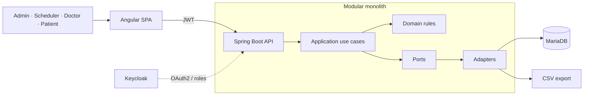

| Portal | What it does |
|---|---|
| 🛡️ Administrator | Manages users, doctors and system configuration |
| 🗓️ Scheduler | Books and reschedules appointments |
| 🩺 Doctor | Manages availability and sees their agenda |
| 🙋 Patient | Requests appointments and checks history |

### `// MORE PROJECTS`

<table>
  <tr>
    <td width="50%"><a href="https://github.com/bCharry15/FrameLog"></a></td>
    <td width="50%"><a href="https://github.com/bCharry15/Energy_predict"></a></td>
  </tr>
  <tr>
    <td width="50%"><a href="https://github.com/bCharry15/Langchain-Langgraph-Ai-Projects"></a></td>
    <td width="50%"><a href="https://github.com/bCharry15/Academic-Projects"></a></td>
  </tr>
</table>

**Also:** [PiedraAzul Desktop](https://github.com/bCharry15/Piedrazul-Medical-Desktop-Application) · [Microkernel Pipelines](https://github.com/bCharry15/Microkernel-Pipelines)

### `// TECH STACK`

---

### `// GITHUB STATS`

 

 

---

<picture>
  <source media="(prefers-color-scheme: dark)" srcset="./art/header-dark.svg">
  <source media="(prefers-color-scheme: light)" srcset="./art/header-light.svg">
  
</picture>

📍 Popayán, Colombia · Open to Opportunities

